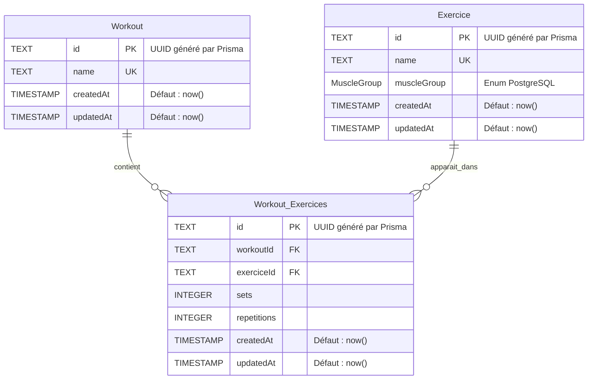

# Diagramme entité-relation — Workout API

Diagramme basé sur les modèles de `prisma/schema.prisma` et leurs types PostgreSQL.

## Relations et contraintes

- Un entraînement peut contenir **zéro à plusieurs exercices**. Un exercice peut apparaître dans **zéro à plusieurs entraînements** : c'est une relation plusieurs-à-plusieurs.
- `Workout_Exercices` est la table d'association. Chaque ligne référence exactement **un entraînement** et **un exercice**, avec ses séries (`sets`) et répétitions (`repetitions`).
- La paire **(`workoutId`, `exerciceId`) est unique** : un exercice ne peut apparaître qu'une fois dans un même entraînement.
- `Workout.name` et `Exercice.name` sont uniques dans leur table respective.
- Supprimer un entraînement ou un exercice supprime ses lignes d'association (`ON DELETE CASCADE`). Supprimer une association ne supprime ni l'entraînement ni l'exercice.
- Tous les champs représentés sont obligatoires (`NOT NULL`). `PK` = clé primaire, `FK` = clé étrangère, `UK` = contrainte d'unicité.

## Enum `MuscleGroup`

`CHEST`, `BACK`, `LEGS`, `SHOULDERS`, `BICEPS`, `TRICEPS`, `ABS`.

Il s'agit d'un type PostgreSQL utilisé par `Exercice.muscleGroup`, pas d'une table supplémentaire.

## Dates et identifiants

Les identifiants sont des UUID générés par Prisma et stockés en `TEXT`, conformément au schéma actuel. Les dates utilisent `TIMESTAMP(3)`.

`createdAt` et `updatedAt` ont une valeur initiale `now()`. Le schéma actuel ne déclare pas `@updatedAt` : il ne garantit donc pas une actualisation automatique de `updatedAt` lors des modifications.
